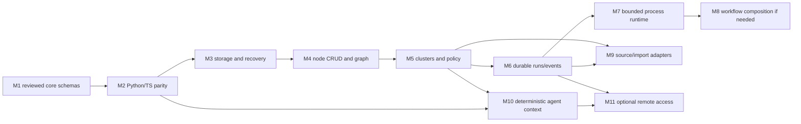

# Phase 2 implementation plan

Historical plan superseded by the [M1.2 dependency roadmap](implementation-roadmap.md). Its old milestone numbering, Core Context Builder proposal and multi-membership defaults are not current requirements: external harnesses own context; O4 stays open. Current production schemas, generated/distribution artifacts and bounded Core M1 exist.

The original delivery finished architecture Phase 2.1. Hardening now implements the illustrative M2 spike, tests, locks and CI definitions. Production schema approval and hosted cross-platform confirmation remain open. M1–M11 below are future implementation milestones; they are not claims of completed software. Start with a contract spike, then prove storage and policy before enabling agent writes. Do not make workflows or remote services prerequisites for basic curated knowledge.

## Dependency graph



Policy is not deferred to M5 for earlier CRUD: M3/M4 require a minimal deny-by-default local principal/capability gate. M5 adds full cluster, sensitivity and approval enforcement. Import preview can begin as a read-only experiment after M2; applying curated changes waits for M5/M6. No milestone depends on HCC, an LLM, Obsidian plugin, message broker or distributed worker.

## Milestones and acceptance gates

| Milestone / goal | Dependencies | Scope / expected artifacts | Out of scope | Acceptance and validation | Main risks |
|---|---|---|---|---|---|
| **M1 Contracts** — freeze a small reviewed core | Architecture review; Q01–Q03 | Approve namespace/IDs/header, Node/Cluster/Relation/provenance and common errors; operation input/output schemas for read/create/replace; move approved examples into `contracts/v1/` explicitly; source mapping notes and fabricated fixtures | Process/workflow production schemas, API server, legacy migration | Every field has semantics/owner; schema/ref checks; valid and targeted-invalid fixtures; lifecycle and operation tables linked to Bxx; human signs unresolved changes | Premature enum/ontology lock-in; treating illustrative schemas as release-ready |
| **M2 Toolchain** — prove cross-language contracts | M1 | Locked Python/npm dev env; Pydantic + TS generation; Ajv/Python validators; package exports; CI parity/drift checks and source hashes | Runtime storage, server/client generation, custom schema compiler | Two clean generations byte-identical; all shared fixtures have matching validator verdicts; valid fixtures round-trip without loss; TS typecheck; Windows/macOS/Linux smoke matrix; no network refs | Optional/null loss, generator approximation, main-doc versus release mismatch |
| **M3 Repository interfaces** — safe canonical writes | M2; Q04/Q07 decisions | Python repository/Git/clock/lock/policy/audit ports; Markdown/YAML codec; workspace config; single writer; staged commit journal; minimal local grants; fake adapters | CRUD surface/graph features, remote sync, new canonical DB | Fault-inject each journal phase; crash/restart rolls forward/back or stops repair-required; conflicting editor writes detected; path traversal/junction/case tests on target OS; old/new committed reader snapshot; hashes and audit preserved | Git/filesystem/database atomicity gap; Windows locking and external editors |
| **M4 Knowledge operations** — small useful managed store | M3 | Read/create/replace/transition for nodes, embedded typed relations, revision lookup; rebuildable SQLite graph index; Python and CLI adapters; integrity diagnostics | Automatic adoption of existing notes, fuzzy semantic dedup, full-text/vector sophistication | B01/B05–B09/B11/B12 tests; stale revision rejected; duplicate idempotency key has one effect; rebuild index yields same nodes/edges; deny checks before reads; no lost manual edit | Two authorities for edges, stale indexes, weak revision reconciliation |
| **M5 Clusters and governance** — usable isolated scopes | M4 | Cluster/membership manifests, Stable/Stack gates, private/session scope, TTL, deterministic bounded policy matching, grant/revoke/approval admin, current-revision Stable eligibility | Arbitrary policy expressions, federation, remote administration | B02–B04 tests; deny beats allow across memberships; private source/target not leaked; changed candidate revision invalidates its promotion approval; prior approved pointer remains readable; expiry enforced without cleanup; revocation after negotiation blocks delivery | Multi-membership escalation, stale approvals, confusing shared with public |
| **M6 State/events** — durable jobs only where needed | M5 | Run/attempt/result/event contracts and SQLite execution store; bounded poll/read/cancel; idempotency retention/reconciliation; local audit recovery | Event broker, global event sourcing, distributed scheduler | B06/B10–B12 tests; late worker fenced; duplicate event safe; terminal outcome immutable; disconnect not rollback; unknown effect becomes indeterminate | Fake exactly-once promises, treating events as knowledge authority |
| **M7 Process runtime** — one resumable bounded procedure | M6 | Ordinary Python process composition; explicit pinned operation steps, safe checkpoints, finite retries/deadlines and budget; e.g. candidate review preparation | Arbitrary scripts/plugins, dynamic agent planner, generic workflow DSL | Resume same definition only; effect receipts avoid duplicate side effects; cancellation at safe point; changed definition rejects checkpoint; failure injection/restart | Unnecessary engine abstraction, retry storms, unsafe serialized state |
| **M8 Workflow composition** — only demonstrated multi-process need | M7 + a concrete use case | Static acyclic dependencies, explicit typed outputs and compensation when required; versioned definition/fixtures | General purpose orchestration UI, dynamic DSL, cross-host workflow scheduling | Small real case beats ordinary Python composition on a stated requirement; bounded fan-out, failing step and compensation tests | Building an orchestration platform before useful knowledge exists; skip milestone if no need |
| **M9 Import/integration** — curate external sources | M5 + M6 for apply; M2 for preview | Source port consuming existing Phase 1 files via configured path; candidate/provenance mapping; review plan; per-item approved application; optional Obsidian read integration | Refactor inventory tools, import all chats by default, auto-promotion, deletion of original exports | Repeated apply idempotent; source/hash/message branch evidence preserved; unresolved refs remain explicit; plan stale snapshot rejected; cancel reports committed items; source files byte-identical | Preliminary classification mistaken for truth; uncontrolled retention of private transcripts |
| **M10 Agent context** — deterministic authorized bundles | M5 + M2; M6 if jobs required | Context request/result schemas; explicit dynamic cluster attachment scoped to session; snapshot manifest/hash; bounded deterministic selection/truncation; MCP stdio adapter when consumer selected | Model-specific prompts as core types, vector nondeterminism, private-memory auto-sharing | B13: equal inputs/snapshot/options yield equal bytes on all OS; deny filtering before expansion/budget; recheck revocation before return; fixture hash and tokenizer version pinned; agent consumer integration test | Token counting differences, hidden denied-data leakage, injection in source text |
| **M11 Remote/scaling** — optional access, then measured scale | M6 + M10; threat model and Q10/Q11 | First choose HTTP REST or MCP HTTP for real consumer; auth/TLS/rate limits, audit, binding contract tests. Separate worker proposal only after local bottleneck measured | Expose everything remotely, broker/Kubernetes by default, universal protocol translator | Authn/authz/Origin/rebinding/revocation tests; errors/CAS/idempotency identical to local; documented latency/load measurements justify workers; unknown effects reconciled | New trust boundary, session leakage, unnecessary distributed consistency |

### Smallest next slice

Approve Q01 (schema namespace), then take **one Node and one Cluster plus shared primitives**, two fabricated valid fixtures and targeted invalid variants. Use the specified mature generators to produce importable Python models and TS declarations; validate identical fixtures with jsonschema/Ajv; preserve missing/null and Unicode round-trip; regenerate twice and compare. Add a minimal typed `get_node` Protocol stub in a test only if needed to demonstrate use. No file writes, services, real vault data or LLM calls are needed. That is the M1/M2 proof, not a miniature platform.

## Proposed portable repository layout

The actual root now includes docs, tools, tests, illustrative Python/TS outputs, locks and CI. ADR-008 defines the whole repository as the reusable boundary. The layout below is a future production proposal, not current runtime scaffolding. Modules need not become separate published packages.

```text
Second-Brain-Modules/                # entire repository/submodule root
  contracts/v1/                     # canonical JSON Schemas, immutable release IDs
  bindings/http/                    # optional OpenAPI binding, no duplicate models
  packages/python/
    pyproject.toml
    src/second_brain_contracts/generated/
    src/second_brain_core/            # application/domain/ports, no transport imports
    src/second_brain_adapters/inbound/
    src/second_brain_adapters/outbound/
  packages/typescript/
    package.json
    src/generated/
    src/adapters/                    # optional clients/Obsidian integration
  tests/fixtures/                    # fabricated shared valid/invalid/semantic cases
  tests/conformance/                 # application and binding tests
  tools/                            # generation/check orchestration, no schema compiler
  migrations/                       # explicit versioned offline migrations
  docs/architecture/
  requirements-contracts.lock
  package-lock.json
  .github/workflows/                 # plain CI; no monorepo framework needed
```

Keep package boundaries simple: two ordinary language packages in one repository initially; split core from contracts distribution only when release cadence/consumer size warrants it. Consumers should be able to install contracts without importing the knowledge engine or adapter SDKs. Dev dependencies never become required just to validate an installed contract package.

Consumer projects own `knowledge/`, local control config, private sources, runtime stores and cache directories. Paths are configured, not assumed. The existing vault's `00 System/` organization remains unchanged. Phase 1 tooling stays at its current location; later extraction into a reusable source-adapter package requires a separate task and license review of its upstream utility. Do not vendor private inventory output into this reusable repository.

## Review and scope discipline

Current requirements: local canonical storage, explicit versions, access controls, typed relations, cross-language contracts, deterministic context and curated imports. Future options: remote endpoints, workflow graphs, distributed workers, semantic retrieval, federation and arbitrary plugin loading. The existence of a contract family does not authorize its runtime implementation.

The principal failure scenarios to prove away are: a manual edit overwritten under a stale revision; approval reused after content changes; membership granting unintended disclosure; a crash between file/Git/journal writes; repeated remote side effects after timeout; generator loss of optional/null fields; and source text interpreted as instructions. Their acceptance tests are assigned above. No capacity numbers are asserted without measurements.
